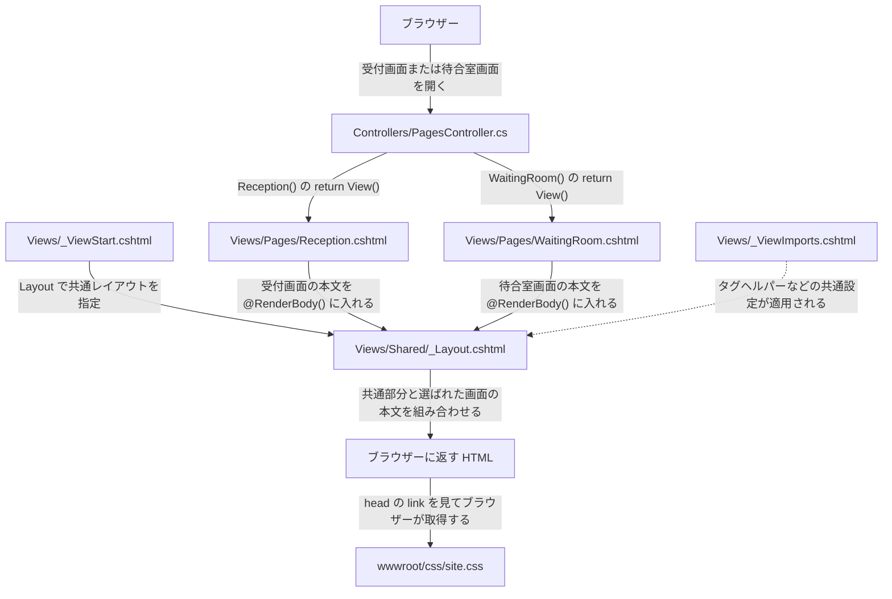

# Razor レイアウトメモ

## フォルダー構成と名前の決まり

```text
WaitingRoom.Web/Views/
├── _ViewImports.cshtml      各ビューで使う @using やタグヘルパーをまとめる
├── _ViewStart.cshtml        各ビューの処理前に共通レイアウトを指定する
├── Pages/
│   ├── Reception.cshtml     受付画面の本文
│   └── WaitingRoom.cshtml   待合室画面の本文
└── Shared/                  複数の画面で使うビューを置く
    └── _Layout.cshtml       共通メニューなどを持ち、画面の本文を差し込む
```

- **`_ViewImports.cshtml` と `_ViewStart.cshtml`** は、Razor が決まった名前で探すので、そのまま使う。先頭の `_` も名前の一部。
- **`_Layout.cshtml`** は共通レイアウトによく使われる名前。変更する場合は、`_ViewStart.cshtml` の `Layout = "_Layout";` も新しい名前に合わせる。WaitingRoom では今の名前で使える。
- **`Shared`** は MVC が共通のビューやレイアウトを探すフォルダー。`Layout = "_Layout";` という短い名前で指定しているので、今の配置では `Views/Shared` を使う。 [Microsoft Learn — ASP.NET Core のレイアウト](https://learn.microsoft.com/ja-jp/aspnet/core/mvc/views/layout?view=aspnetcore-10.0#specifying-a-layout)

## ファイルのつながり

矢印のそばに「どのファイルが何を渡すか」を示す。2つの画面はそれぞれの本文を持ち、同じレイアウトで表示される。



| ファイル | 何を担当するか | WaitingRoom で見る箇所 |
|---|---|---|
| `PagesController.cs` | URL に対応するアクションで、表示するビューを選ぶ。 | `Reception()` の `return View();` で、同じ名前の `Reception.cshtml` が選ばれる。 |
| `Reception.cshtml` | 受付画面の本文を作る。 | 「受付番号を発行」など、受付のボタンや表示欄を書く。 |
| `WaitingRoom.cshtml` | 待合室画面の本文を作る。 | 呼び出し中の番号や待機人数の表示欄を書く。 |
| `_ViewStart.cshtml` | 画面のビューを処理する前に、使うレイアウトを指定する。 | `Layout = "_Layout";` で、2つの画面に同じひな形を使う。 |
| `_ViewImports.cshtml` | `Views/` 配下の `.cshtml` に、名前空間やタグヘルパーの設定を適用する。 | `@addTagHelper` があるので、共通メニューの `asp-controller="Home" asp-action="Index"` から ASP.NET Core がリンク先の URL を作れる。 |
| `_Layout.cshtml` | 共通メニューやフッターを持ち、画面ごとの本文を入れる。 | `@RenderBody()` が本文の差し込み位置。共通 CSS の `<link>` は `<head>` にある。 |
| `site.css` | 共通の見た目を指定する。 | ブラウザーが完成した HTML の `<link>` を見て `/css/site.css` を読み込む。 |

`_ViewImports.cshtml` の設定は、図にある `_Layout.cshtml` に加え、`Reception.cshtml` や `WaitingRoom.cshtml` にも適用される。

**受付画面を例に口頭で説明するなら**

> 受付画面を開くと、`PagesController` が `Reception.cshtml` を選びます。`_ViewStart.cshtml` が共通の `_Layout.cshtml` を指定しているので、受付のボタンなどがレイアウトの `@RenderBody()` の場所に入ります。ブラウザーは、できあがった HTML の `<link>` を見て共通 CSS を読み込みます。

## `_ViewStart.cshtml` の役割

`_ViewStart.cshtml` は、Razor が画面のビューを処理する前に実行するファイル。WaitingRoom では `Views/` に置いているので、配下の `Pages/Reception.cshtml` や `Pages/WaitingRoom.cshtml` などに共通の設定を適用できる。

[`_ViewStart.cshtml` の2行目](../WaitingRoom.Web/Views/_ViewStart.cshtml#L2) では、使うレイアウトを次のように指定している。

```razor
@{
    Layout = "_Layout";
}
```

受付画面を開くと、`PagesController` が `Reception.cshtml` を選ぶ。Razor は画面を処理する前に `Layout = "_Layout";` を読み、WaitingRoom では [`Views/Shared/_Layout.cshtml`](../WaitingRoom.Web/Views/Shared/_Layout.cshtml) を使う。その中の `@RenderBody()` の位置に受付画面の内容が入る。待合室画面も同じレイアウトを使うので、共通のナビゲーションはレイアウト側にまとめられる。

## フッターのタグと Privacy リンク

受付画面や待合室画面の下に出るフッターは、共通レイアウトに書いてある。 [`Views/Shared/_Layout.cshtml`](../WaitingRoom.Web/Views/Shared/_Layout.cshtml#L49)

```razor
<footer class="border-top footer text-muted">
    <div class="container">
        &copy; 2026 - WaitingRoom.Web - <a asp-area="" asp-controller="Home" asp-action="Privacy">Privacy</a>
    </div>
</footer>
```

### フッターの見た目を決める部分

| 書き方 | 意味 |
|---|---|
| `<footer>` | ページのフッターを表す HTML タグ。ここでは著作権表記とリンクをまとめる。 |
| `class="border-top footer text-muted"` | 空白で区切った3つのクラスを同じ要素に付ける。 |
| `border-top` | Bootstrap のクラス。フッターの上に境界線を引く。 |
| `footer` | このプロジェクトの CSS クラス。下端の位置、幅、行の高さなどを指定する。定義は [`_Layout.cshtml.css`](../WaitingRoom.Web/Views/Shared/_Layout.cshtml.css#L42) にある。 |
| `text-muted` | Bootstrap のクラス。文字色を控えめな色にする。 |
| `<div class="container">` | 中身をまとめる箱。Bootstrap の `container` が左右に余白を取り、画面幅に応じて中身の最大幅を調整する。 |
| `&copy;` | ブラウザーに著作権記号 © を表示するための HTML の書き方。 |

Bootstrap の各クラスの説明は公式ドキュメントで確認できる。 [境界線](https://getbootstrap.com/docs/5.3/utilities/borders/) · [文字色](https://getbootstrap.com/docs/5.3/utilities/colors/) · [コンテナー](https://getbootstrap.com/docs/5.3/layout/containers/)

### Privacy リンクの行き先を決める部分

| 書き方 | 意味 |
|---|---|
| `<a>…</a>` | リンクを表す HTML タグ。タグの間にある `Privacy` が画面に表示される。 |
| `asp-area=""` | 管理画面などをまとめる MVC の区分（Area）を指定する属性。空文字は Area に属さない行き先を指定する。 |
| `asp-controller="Home"` | `HomeController` を指定する。ここではクラス名の末尾の `Controller` を省いて書く。 |
| `asp-action="Privacy"` | `HomeController` の `Privacy()` を指定する。 |

1. サーバーが画面を作るとき、`_ViewImports.cshtml` の `@addTagHelper` で有効になったアンカー タグヘルパーが `asp-` 属性を読む。 [`_ViewImports.cshtml`](../WaitingRoom.Web/Views/_ViewImports.cshtml#L12)
2. タグヘルパーが `Program.cs` のルーティング設定を使って URL を組み立てる。WaitingRoom では、ブラウザーに `<a href="/Home/Privacy">Privacy</a>` が届く。 [`Program.cs`](../WaitingRoom.Web/Program.cs#L40) · [Microsoft Learn — アンカー タグヘルパー](https://learn.microsoft.com/ja-jp/aspnet/core/mvc/views/tag-helpers/built-in/anchor-tag-helper?view=aspnetcore-10.0)
3. 利用者がリンクをクリックすると、ブラウザーが `/Home/Privacy` にアクセスする。`HomeController.Privacy()` の `return View();` で `Views/Home/Privacy.cshtml` が選ばれる。 [`HomeController.cs`](../WaitingRoom.Web/Controllers/HomeController.cs#L14) · [`Privacy.cshtml`](../WaitingRoom.Web/Views/Home/Privacy.cshtml)

今の Privacy ページは、プライバシーポリシーを書くためのテンプレート。Chrome でフッターの「Privacy」を右クリックして「検証」を選ぶと、生成された `href` を確認できる。

### Area が違えば同じ名前のアクションを使える

MVC は **Area 名・コントローラー名・アクション名**の組み合わせで行き先を区別する。たとえば、今の `HomeController` とは別に、管理画面用の `HomeController` を作り、そちらにも `Privacy()` を定義できる。

| リンクの指定 | 対応するアクション | URL の例 |
|---|---|---|
| `asp-area=""` | 現在の `HomeController.Privacy()` | `/Home/Privacy` |
| `asp-area="Admin"` | `[Area("Admin")]` を付けた管理画面用の `HomeController.Privacy()` | `/Admin/Home/Privacy` |

どちらのリンクも `asp-controller="Home"` と `asp-action="Privacy"` は同じ。学習用の [管理用 HomeController.cs](../WaitingRoom.Web/Areas/Admin/Controllers/HomeController.cs) は、通常のコントローラーと別の名前空間に置いている。`[Area("Admin")]` で MVC 上の所属を指定し、`[HttpGet("/Admin/Home/Privacy")]` でブラウザーから開く URL を指定する。管理用の `Privacy()` はファイルのパスを指定して、通常の `Privacy()` と同じ `Views/Home/Privacy.cshtml` を返す。 [Microsoft Learn — ASP.NET Core の Areas](https://learn.microsoft.com/ja-jp/aspnet/core/mvc/controllers/areas?view=aspnetcore-10.0)

## 図「Order of Views Execution」の読み方

図の `ControllerName` は、WaitingRoom なら `Pages` に当たる。`ViewName.cshtml` は、受付画面なら `Reception.cshtml` に当たる。図の `_LayoutView.cshtml` に当たるファイルは `Views/Shared/_Layout.cshtml`。

| 図に出てくるもの | WaitingRoom での役割 |
|---|---|
| `return View();` | `PagesController` の `Reception()` から、受付画面のビューを表示するよう MVC に伝える。 |
| `_ViewImports.cshtml` | `@using` や `@addTagHelper` など、配下のビューで共通に使う Razor の設定を書く。親フォルダの設定から順に適用される。 |
| `_ViewStart.cshtml` | 画面のビューが実行される前に動く。`Layout = "_Layout";` で共通レイアウトを指定する。親と子の両方にあれば、親から子の順に実行される。 |
| `Reception.cshtml` | 「受付番号を発行」ボタンなど、受付画面に固有の HTML を作る。 |
| `Shared/_Layout.cshtml` | 共通メニューやフッターを作り、`@RenderBody()` に受付画面の HTML を入れる。共通 CSS を読み込む `<link>` もここにある。 |

WaitingRoom には `Views/` 直下に `_ViewImports.cshtml` と `_ViewStart.cshtml` がある。図では `ControllerName` フォルダにも同名のファイルがある例を示している。`_ViewImports.cshtml` はビューに共通の設定を適用する仕組みで、`_ViewStart.cshtml` のように画面を開くたびに実行される処理とは役割が異なる。 [Microsoft Learn — ASP.NET Core のレイアウト](https://learn.microsoft.com/ja-jp/aspnet/core/mvc/views/layout?view=aspnetcore-10.0)

図の出典は Udemy 講座『Asp.Net Core 10 (.NET 10) | True Ultimate Guide』の「Layout Views [MVC]」にある `_ViewStart.cshtml` のレクチャー。該当スライドは動画の 0:39 頃。 [Udemy — 講座ページ](https://www.udemy.com/course/asp-net-core-true-ultimate-guide-real-project/)
