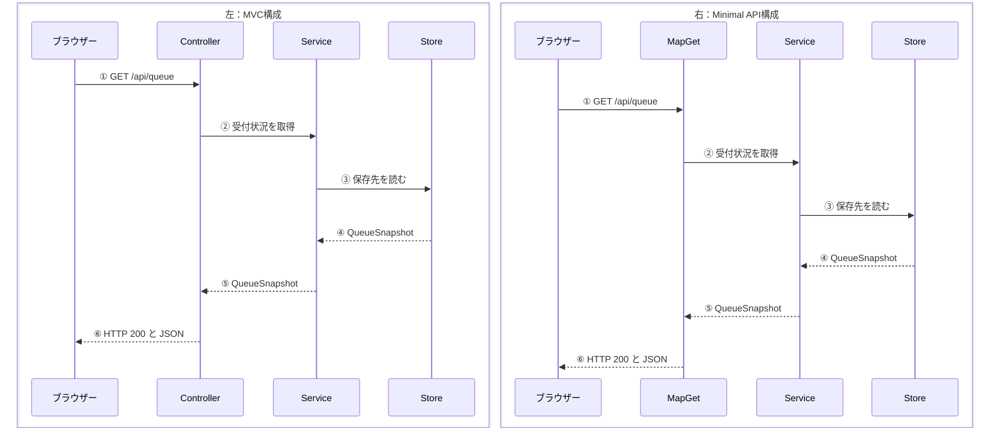

# 初学者向け GET /api/queue のコードの読み方

Minimal APIで `MapGet` を使ったことがある人向けに、Controllerで書いたAPIの追い方を説明します。このAPIは、呼び出し中の番号と、発行順に並んだ待機番号を取得します。

## 1. QueueController.csで入口を見つける

[QueueController.cs](../../WaitingRoom.Web/Controllers/QueueController.cs) を開き、クラスの上の `[Route("api/queue")]` と、メソッドの上の `[HttpGet]` を探します。この2つが、Minimal APIでいう `MapGet("/api/queue", ...)` のURLとHTTPメソッドに当たります。リクエストが届いたら、`Get()` の中が実行されます。

`Get()` の最初の行にある `_queueService.GetSnapshotAsync(...)` が次の行き先です。`_queueService` は、ASP.NET Coreがコンストラクターに渡した `QueueService` を保存したものです。この受け渡しをDI（依存性注入）と呼びます。

## 2. QueueService.csで次の呼び出しを見る

[QueueService.cs](../../WaitingRoom.Web/Services/QueueService.cs) の `GetSnapshotAsync()` を開くと、今度は `_queueStore.GetSnapshotAsync(...)` を呼んでいます。ここで `_queueStore` の型を確認すると、[IQueueStore](../../WaitingRoom.Web/Stores/IQueueStore.cs) です。これは「受付状況を取得できる」という取り決めを表すインターフェースです。

## 3. Program.csで実際に呼ばれるStoreを探す

[Program.cs](../../WaitingRoom.Web/Program.cs) の `AddSingleton<IQueueStore, InMemoryQueueStore>()` を見ます。この登録により、Serviceが `IQueueStore` を必要としたとき、ASP.NET Coreは `InMemoryQueueStore` を渡します。この登録はアプリの起動時に行います。

## 4. InMemoryQueueStore.csで値を見て、Controllerに戻る

[InMemoryQueueStore.cs](../../WaitingRoom.Web/Stores/InMemoryQueueStore.cs) の `GetSnapshotAsync()` は、メモリに保持している待機番号をコピーして、[QueueSnapshot](../../WaitingRoom.Web/Models/QueueSnapshot.cs) を返します。初期状態では、呼び出し中の番号は `null`、待機番号の一覧は空です。

最後にControllerの `Get()` に戻り、`return Ok(snapshot);` を見ます。`Ok` はHTTP 200を表し、ASP.NET Coreが `snapshot` をJSONに変換してブラウザーに返します。

```json
{
  "callingNumber": null,
  "waitingNumbers": []
}
```

## MVCとMinimal APIの呼び出し順を比べる

左がこのプロジェクトのMVC構成、右がMinimal APIで書いた場合です。上から順に読むと、どこでデータを取りに行き、どの順で戻るかが分かります。

| MVC構成（Controller版） | Minimal API構成（MapGet版） |
|---|---|
| **①** ブラウザー → `QueueController.Get()` | **①** ブラウザー → `MapGet` に渡した処理 |
| **②** `QueueController` → `QueueService` | **②** `MapGet` の処理 → `QueueService` |
| **③** `QueueService` → `InMemoryQueueStore` | **③** `QueueService` → `InMemoryQueueStore` |
| **④** Store → Service に `QueueSnapshot`（モデル）が戻る | **④** Store → Service に同じ `QueueSnapshot` が戻る |
| **⑤** Service → Controller にモデルが戻る | **⑤** Service → `MapGet` の処理にモデルが戻る |
| **⑥** Controller → ブラウザーに HTTP 200 と JSON を返す | **⑥** `MapGet` の処理 → ブラウザーに HTTP 200 と JSON を返す |

ここで比べているのは、`GET /api/queue` がJSONを返す流れです。MVCのViewは、受付画面や待合室画面のHTMLを返すときに使います。

### 左右で見るシーケンス図

左がMVC構成、右がMinimal API構成です。同じ番号の矢印を見比べます。



## 同じ一覧取得をMVCとMinimal APIのコードで比べる

どちらも `GET /api/queue` を受け、同じ `QueueService` から受付状況を取得し、HTTP 200で返す例です。

### MVC版（Controller）

`[Route]` と `[HttpGet]` で入口を決めます。コンストラクターで受け取った `QueueService` を呼び、`Ok(snapshot)` で結果を返します。

```csharp
[ApiController]
[Route("api/queue")]
public sealed class QueueController : ControllerBase
{
    private readonly QueueService _queueService;

    public QueueController(QueueService queueService)
    {
        _queueService = queueService;
    }

    [HttpGet]
    public async Task<ActionResult<QueueSnapshot>> Get(CancellationToken cancellationToken)
    {
        var snapshot = await _queueService.GetSnapshotAsync(cancellationToken);
        return Ok(snapshot);
    }
}
```

### Minimal API版（MapGet）

`MapGet` で入口を決めます。そこに渡す処理の引数で `QueueService` を受け取り、`Results.Ok(snapshot)` で結果を返します。

```csharp
app.MapGet(
    "/api/queue",
    async (
        QueueService queueService,
        CancellationToken cancellationToken) =>
    {
        var snapshot = await queueService.GetSnapshotAsync(cancellationToken);
        return Results.Ok(snapshot);
    });
```

## Minimal APIからController版・MVCにすると何が増えるか

| 範囲 | 増えるもの・変わるもの |
|---|---|
| **一覧取得APIの入口** | `Program.cs` の `MapGet` に相当する処理を、`QueueController.cs` の `Get()` に置く。URLとGETは属性で指定する。 |
| **アプリの起動設定** | 今回の `Program.cs` では `AddControllersWithViews()` でControllerとViewを使えるようにし、`MapControllerRoute(...)` でルーティングを設定する。 |
| **画面のHTMLもC#から返す場合** | 画面用の `PagesController` と、受付・待合室の `.cshtml` を `Views/Pages/` に追加する予定。これは画面を開くための処理で、一覧取得APIはJSONを返す。 |

`QueueService`、`IQueueStore`、`InMemoryQueueStore`、`QueueSnapshot` は両方で使えます。受付状況の取得とデータの形を共通にして、HTTPリクエストを受ける入口だけを差し替えられます。

上のコード例は、入口とデータ取得の比較に絞っています。実際の `QueueController` には、更新時に古い応答を使い回さないための `[ResponseCache(...)]` もあります。
