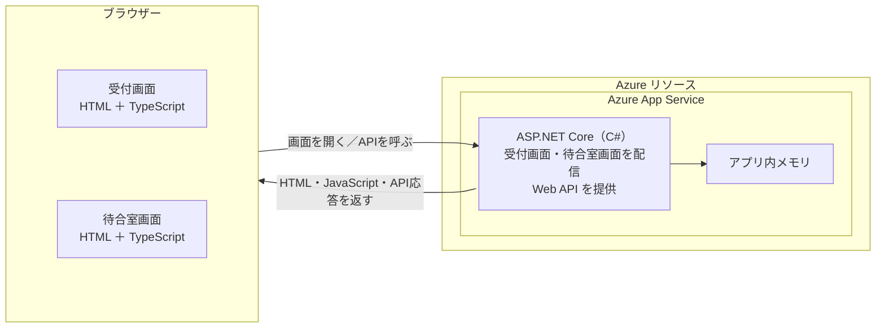
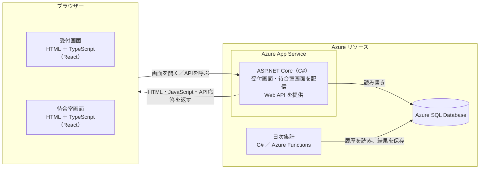

# クリニック待合室の受付・呼び出しシミュレーター 詳細設計

架空のクリニックで、受付係が発行した受付番号を順番に呼び出す。待合室では、呼び出し中の番号と待機人数を確認できる。番号だけでやり取りする、窓口1つの学習用デモとする。

## システム構成

### 初版（実装済み）

Azure App Service 上の ASP.NET Core アプリが、MVC のビューと Web API を提供する。ブラウザーで動く TypeScript 由来の JavaScript が、番号の発行や呼び出しなどの操作に応じて API を呼ぶ。待合室画面は、開いたときと「更新」を押したときに受付状況を取得する。



`InMemoryQueueStore` は受付状況をアプリのメモリに保持する。アプリを再起動すると受付状況と発行番号は初期化される。

### 第2版（計画）

引き続き Azure App Service で受付画面、待合室画面、Web API を提供する。第2版では両画面に React を使う。受付画面は発行・呼び出し・案内完了の操作後に表示を更新し、待合室画面は既存の受付状況 API から定期的に取得した値を表示に反映する（FR-06）。



受付データの保存先を Azure SQL Database に切り替え、再起動後も待機列と発行番号を引き継ぐ（FR-07）。Azure Functions は毎日決まった時刻に前日分の発行件数を集計し、結果をデータベースへ保存する。受付画面は Web API から保存済みの結果を取得する（FR-08）。

## 画面（初版）

| 画面 | URL | 表示・操作 |
|---|---|---|
| ホーム | `/` | 現在のデモでは、受付画面と待合室画面へのボタンを表示する。 |
| 受付 | `/Pages/Reception` | 受付番号を発行する。待機中の番号を発行順に表示し、「次を呼ぶ」「案内完了」で状態を更新する。 |
| 待合室 | `/Pages/WaitingRoom` | 呼び出し中の番号を大きく表示し、待機人数を示す。「更新」で最新の状況を取得する。 |

[受付画面のモックアップ](images/受付画面.png) · [待合室画面のモックアップ](images/待合室画面.png) · [ボタンとAPIの対応図](images/呼び出すAPI図解.png)

## 受付のルール

- 受付番号は `A001` から順に発行する。
- 受付の状態は「待機中 → 呼び出し中 → 案内完了」と進む。
- 「次を呼ぶ」は、待機中のうち最も早く発行された番号を選ぶ。呼び出し中の番号は同時に1件までとする。
- 「案内完了」は、画面が指定した番号が現在呼び出し中の場合に成立する。
- C#側で状態を判定し、判定と更新をまとめて行う。2つの受付画面から同時に操作されても、呼び出し中の番号は1件に保つ。

## Web API

| メソッドとパス | 処理 |
|---|---|
| `GET /api/queue` | `200 OK` で、呼び出し中の番号を `callingNumber`、発行順に並んだ待機番号を `waitingNumbers` として返す。初期値はそれぞれ `null` と空配列。 [初学者向けコードの読み方](notes/api/queue.md) |
| `POST /api/tickets` | リクエスト本文は不要。新しい番号を発行して待機列に追加し、HTTP 201と `{"number":"A001"}` の形式で発行番号を返す。 |
| `POST /api/queue/call-next` | 次の待機番号を呼び出す。成功時は `200 OK` と `{"number":"A001"}` の形式で呼び出した番号を返す。待機者がいない場合や呼び出し中の場合は `409 Conflict` を返す。 |
| `POST /api/tickets/{number}/complete` | リクエスト本文は不要。呼び出し中の番号の案内を完了し、HTTP `204` を返す。未発行の番号なら `404`、待機中または案内完了済みなら `409` を返す。 |

## フォルダ構成と役割

ASP.NET Core MVCで2つの画面を返し、ブラウザー上の操作は `WaitingRoom.Client` のTypeScriptで実装する。次のツリーは初版の実装と、現在の主な資料の配置を示す。

```text
WaitingRoom/                           リポジトリのルート
├── WaitingRoom.slnx
├── WaitingRoom.Web.http                手動でAPIを確認するリクエスト集
├── README.md
├── AGENTS.md
├── docs/
│   ├── 要件定義.md
│   ├── 確認項目.md
│   ├── 詳細設計.md
│   ├── tests/                        動作確認の手順と結果
│   │   ├── 結合テスト.md
│   │   └── 単体テスト.md
│   ├── notes/                        学習メモ
│   │   ├── api/queue.md               受付状況APIの読み方
│   │   ├── MSTestメモ.md
│   │   ├── Reactメモ.md
│   │   ├── AzureSQLDatabaseメモ.md
│   │   ├── AzureFunctionsFAQ.md
│   │   ├── Razorレイアウトメモ.md
│   │   └── デバッグメモ.md
│   └── images/
├── WaitingRoom.Web/                   C#／ASP.NET Core MVC
│   ├── WaitingRoom.Web.csproj
│   ├── Program.cs                     起動とルーティングの設定
│   ├── Areas/Admin/Controllers/
│   │   └── HomeController.cs          Area のルーティングを学ぶための参考例
│   ├── Controllers/
│   │   ├── PagesController.cs         受付画面・待合室画面を返す
│   │   ├── QueueController.cs         受付状況の取得・次の番号の呼び出し
│   │   └── TicketsController.cs       番号の発行・案内完了
│   ├── Models/
│   │   ├── QueueSnapshot.cs           呼び出し中の番号と待機番号の一覧
│   │   ├── TicketCompletionResult.cs  案内完了の結果
│   │   └── TicketNumberResponse.cs   発行・呼び出しで返す受付番号
│   ├── Services/
│   │   └── QueueService.cs            受付処理の窓口。処理を IQueueStore に依頼する
│   ├── Stores/
│   │   ├── IQueueStore.cs             受付状況の取得・番号発行・呼び出し・案内完了の契約
│   │   └── InMemoryQueueStore.cs      受付状態をメモリに保持し、判定と更新を行う
│   ├── Views/
│   │   ├── _ViewImports.cshtml        各ビューで共通に使う Razor のディレクティブを指定する
│   │   ├── _ViewStart.cshtml          各画面の共通レイアウトに Shared/_Layout.cshtml を指定する
│   │   ├── Pages/
│   │   │   ├── Reception.cshtml       受付画面
│   │   │   └── WaitingRoom.cshtml     待合室画面
│   │   └── Shared/                    複数の画面で使うビューを置く
│   │       └── _Layout.cshtml         共通の <head>、ナビゲーション、フッターを定義する
│   └── wwwroot/                       ブラウザーに公開するファイルの基準フォルダ
│       ├── js/
│       │   ├── reception.js           受付画面のコンパイル結果
│       │   └── waiting-room.js        待合室画面のコンパイル結果
│       └── css/
│           ├── site.css               共通の見た目
│           ├── reception.css          受付画面の見た目
│           └── waiting-room.css       待合室画面の見た目
├── WaitingRoom.Web.Tests/             受付ルールの単体テスト
│   ├── WaitingRoom.Web.Tests.csproj
│   ├── MSTestSettings.cs
│   └── InMemoryQueueStoreTests.cs
└── WaitingRoom.Client/                TypeScriptのソースとビルド設定
    ├── package.json
    ├── tsconfig.json
    └── src/
        ├── reception.ts              受付画面のAPI通信・ボタン操作・表示更新
        └── waiting-room.ts           待合室画面のAPI通信・表示更新
```

画面のひな形は `Views/Pages/` に置く。受付画面で使う `reception.ts` は `WaitingRoom.Client` で管理し、コンパイル後の `reception.js` を `WaitingRoom.Web` の `wwwroot/js/` に配置する。ブラウザーは受付画面のHTMLを受け取った後、`/js/reception.js` を読み込む。

たとえば、TypeScript側は初版では少数のファイルを `WaitingRoom.Client/src/` に直接置く。受付・待合室の画面処理や共通処理が増えたら、次のように分けられる。

- `src/api/` に、複数の画面で使うAPI通信をまとめる。
- `src/pages/` に、受付画面や待合室画面ごとのボタン操作と表示更新を置く。
- `src/styles/` に、画面で使うCSSをまとめる。

配置を変更した場合は、この設計書のツリーと説明も実際の構成に合わせて更新する。

| 設計の判断 | 理由と根拠 |
|---|---|
| 画面の土台を `Views/Pages/` に置く | ASP.NET Core MVCではControllerがViewを選び、既定の規則で `Views/コントローラー名/ビュー名.cshtml` を探す。そこで `PagesController` に対応する2画面を `Views/Pages/` に置く。 [Microsoft Learn — MVCのビュー検出](https://learn.microsoft.com/ja-jp/aspnet/core/mvc/views/overview?view=aspnetcore-10.0#view-discovery) |
| 画面のURLを `PagesController` に割り当てる | `Program.cs` のルーティング設定に従い、`/Pages/Reception` は `Reception()`、`/Pages/WaitingRoom` は `WaitingRoom()` を呼ぶ。それぞれのアクションが対応する `.cshtml` を選び、ブラウザーにHTMLを返す。 [Microsoft Learn — コントローラーへのルーティング](https://learn.microsoft.com/ja-jp/aspnet/core/mvc/controllers/routing?view=aspnetcore-10.0) |
| Controller、Service、Storeの役割を分ける | ControllerはHTTPリクエストを受け取り、処理結果をHTTP応答に変換する。`QueueService` は受付処理の窓口となり、`IQueueStore` に処理を依頼する。初版の `InMemoryQueueStore` は、発行順や現在の呼び出し状態を確認し、同時操作を制御しながら受付状態を更新する。 |
| Visual Studioで `WaitingRoom.Web`、VS Codeで `WaitingRoom.Client/` を開発する | C# 側はVisual Studioでビルド・デバッグし、TypeScript側はVS Codeで編集し、`tsconfig.json` に従ってJavaScriptに変換する。今回は `WaitingRoom.Client` をVisual Studioのソリューションにプロジェクトとして追加しないため、`.esproj` は不要。 |
| CSSと変換後のJavaScriptを `wwwroot/` から配信する | ASP.NET Coreの既定の静的ファイル配置に合わせ、CSSと生成済みJavaScriptを `wwwroot/` に置く。 [Microsoft Learn — 静的ファイルの配信](https://learn.microsoft.com/ja-jp/aspnet/core/fundamentals/static-files?view=aspnetcore-10.0) |

**画面を開くとき**は `PagesController` がViewを選び、ASP.NET Coreが最初のHTMLを返す。**「次を呼ぶ」を押したとき**は TypeScriptが `POST /api/queue/call-next` を送信する。`QueueController` が番号を指定せずに `QueueService` に処理を依頼し、ServiceがStoreに依頼する。Storeが呼び出せる番号を選んで状態を更新し、Controllerが結果をHTTP応答にする。成功したら、TypeScriptは `GET /api/queue` で受付状況を取り直し、画面を更新する。

## 第2版の変更設計

React（FR-06）と Azure Functions（FR-08）の実装方法は暫定案とする。学習や試作で動作を確認し、必要に応じて見直す。

### FR-06 待合室の表示を自動更新する（案）

**受付で番号を発行すると、待合室の待機人数が次の自動更新で増える。**

| いつ | 何をするか |
|---|---|
| 画面を開いたとき、その後5秒ごと、「更新」を押したとき | TypeScript が同じ取得処理で `GET /api/queue` を呼ぶ。取得中は［更新］を無効にし、タイマーの更新が重なったら進行中の結果を待つ。 |
| 初回の取得中 | ［更新］の下に「受付状況を取得中…」と表示する。 |
| 取得に成功したとき | React が `callingNumber` と `waitingNumbers.length` を表示する。番号がなければ「呼び出し中の番号はありません」と表示する。エラー表示があれば消す。 |
| 取得に失敗したとき | ［更新］の下に「最新の受付状況を取得できませんでした」と表示する。前回の値があればその値を、初回なら「未取得」を表示する。次の自動更新で取り直す。 |
| 画面を離れたとき | タイマーを停止する。 |

- `WaitingRoom.cshtml` に React の組み込み先を用意する。React が番号、人数、手動の「更新」ボタンを表示する。
- `Reception.cshtml` にも React の組み込み先を用意する。React が受付操作のボタン、呼び出し中の番号、待機列を表示する。各操作には既存の受付 API を使い、成功後に取得した受付状況を React の状態に反映する。
- 受付画面も、開いた直後に `GET /api/queue` を呼ぶ。取得中は「受付状況を取得中…」と表示し、番号発行ボタンを無効にする。取得に失敗した場合は［再取得］を表示し、その下に「受付状況を読み込めませんでした。」と表示する。前回のデータがある場合はその表示を残し、「受付状況を更新できませんでした。」と伝える。［再取得］は同じ GET を呼ぶ。
- 番号発行中はボタンを「発行中…」に切り替えて無効にする。発行リクエストがエラーになった場合は、発行ボタンの下に「発行できませんでした。」と表示し、一覧を取り直す。発行成功後に一覧の取得だけが失敗した場合も、発行済みの番号を表示する。
- 開発時も発行時も、Web プロジェクトのビルド前に Vite で両画面の JavaScript を `wwwroot/js/react/` に生成する。受付画面は `/js/react/reception.js`、待合室画面は `/js/react/waiting-room.js` を読み込む。React 用の型チェック設定は両画面で使う。 [Vite 公式｜バックエンドとの統合](https://vite.dev/guide/backend-integration)

画面の全体を把握しやすいように、既存の表示とボタンを役割ごとに分ける。`WaitingRoom.tsx` と `Reception.tsx` が状態と API 通信を担当する。子コンポーネントは親から表示する値とボタンの処理を受け取る。

```text
WaitingRoom.Client/src/components/
├─ waiting-room/
│  ├─ CallingNumber.tsx  呼び出し中の番号と案内文
│  └─ WaitingCount.tsx   待機人数と更新ボタン
└─ reception/
   ├─ TicketIssue.tsx    番号発行ボタンと発行結果
   ├─ CurrentCall.tsx    呼び出し中の番号と案内完了ボタン
   └─ WaitingList.tsx    待機番号の一覧と次を呼ぶボタン
```

### FR-07 再起動後も受付を続ける（案）

**再起動しても呼び出し中の番号と待機順が残り、次の番号を続きから発行できる。**

1. アプリの起動設定で、`QueueService` が使う `IQueueStore` を Azure SQL Database 用の実装に切り替える。
2. 発行時は `Tickets` に1行追加し、`QueueState` の連番を更新する。呼び出しや案内完了では `Tickets` の受付状態を更新する。
3. 再起動後はデータベースから受付状況を取得する。たとえば `A001` が呼び出し中で `A002` が待機中なら、その状態を表示し、次に `A003` を発行する。

| 項目 | 設計 |
|---|---|
| `Tickets` | 発行順を表す連番（主キー）、発行日時（UTC）、受付状態（待機中・呼び出し中・案内完了）を保存する。待機列は連番順で表示する。連番1の表示は `A001`。 |
| `QueueState` | 窓口ごとに1行で、最後に発行した連番を保持する。初期値は0。 |
| 同時に操作された場合 | 発行・呼び出し・案内完了は `QueueState` の同じ行に更新ロックを取り、処理が確定するまで保持する。採番と保存はまとめて確定し、`Tickets` の主キーでも連番の重複を防ぐ。 |
| 初版からの切り替え | 窓口の操作を終えてから空のデータベースで始める。初回は `A001`。テストにはテスト用のデータベースを使う。 [結合テストの第2版の確認](tests/結合テスト.md#第2版の確認) |

列名、データ型、制約、初期データは [テーブル定義書](テーブル定義書.md) を参照する。

#### 保存先の設定

保存方式は [`appsettings.json`](../WaitingRoom.Web/appsettings.json) の `QueueStore:Provider` で選ぶ。`InMemory` はメモリ保存、`Sql` は Azure SQL Database に保存する。起動時に [`Program.cs`](../WaitingRoom.Web/Program.cs) がこの値を読み、`QueueService` が使う `IQueueStore` の実装を登録する。切り替えるときは `Provider` の値を変更し、アプリを再起動する。

受付画面と待合室画面の上部には、登録された `IQueueStore` に応じて「メモリ保存」または「データベース保存」を表示する。

| 設定する場所 | 役割 |
|---|---|
| [`appsettings.json`](../WaitingRoom.Web/appsettings.json) | 保存方式を指定する。 |
| ローカルの `secrets.json` | `ConnectionStrings:WaitingRoom` に開発用 DB の接続文字列を設定する。Visual Studio では `WaitingRoom.Web` を右クリックし、［ユーザー シークレットの管理］から開く。 |
| Azure App Service のアプリ設定 | `Sql` で公開する場合は、`ConnectionStrings__WaitingRoom` に公開先で使う DB の接続文字列を設定する。 |

`appsettings.json` の `Provider` は、ローカルでの起動と公開先の両方に適用される。ローカルの `secrets.json` は公開先に配布されないため、`Sql` で公開する場合は事前に App Service の接続設定を用意する。`Sql` を選んだ状態で接続文字列が未設定だと、起動時にエラーになる。

#### 開発用DBの初期化

[初期化SQL](../Database/reset-dev-queue-data.sql) は、`waitingroom-dev` の受付履歴を削除し、次の発行番号を `A001` に戻す。公開中のアプリも同じDBを使う場合、公開画面の呼び出し中の番号、待機列、採番もリセットされる。

1. Visual StudioのSQLエディターでファイルを開き、`waitingroom-dev` に接続する。Azureポータルのクエリ エディターを使う場合は、同じDBを開き、ファイルの内容を貼り付ける。
2. `@ConfirmReset = 0` のまま、文字を選択せずにSQL全体を実行する。結果欄に「初期化は実行されませんでした。」と表示される。
3. 受付履歴を削除してよいことを確認してから、実行するクエリの `@ConfirmReset` を `1` に変更し、SQL全体を実行する。`TicketCount = 0` と `LastIssuedNumber = 0` を確認し、フラグを `0` に戻す。リポジトリに保存する値は `0` とする。

### FR-08 日ごとの受付件数を確認する（案）

**受付画面で、前日までの7日分の発行件数を確認できる。**

| 段階 | 何をするか |
|---|---|
| 起動する | Web アプリとは別の Function App で、毎日 **午前0時5分（日本時間）** にタイマーが集計処理を起動する。タイマー設定は **15時5分（UTC）** とし、日本時間の前日を集計処理に渡す。 [Microsoft Learn｜Azure Functions のタイマートリガー](https://learn.microsoft.com/ja-jp/azure/azure-functions/functions-bindings-timer) |
| 数える | 指定された日付の日本時間0時から翌日0時より前までに発行した番号を、受付状態を問わず数える。日時の範囲は UTC に直して `Tickets` の発行日時と比較する。発行履歴を丸1日分記録できた日から集計する。 |
| 保存する | FR-07 と同じデータベースの `DailyReceptionCounts` に、日本時間の集計日（主キー）と件数を保存する。再集計するときは対象の日付を指定し、その日の行を更新する。 |
| 表示する | 受付画面が `DailyReportsController` の `GET /api/reports/daily` を呼び、前日までの7日分を新しい順に表示する。発行がなかった日は「0件」、集計結果が未保存の日は「集計結果なし」と表示する。 |

### FR-09 受付画面と待合室画面を見やすくする（案）

FR-06で作る React コンポーネントを、Tailwind CSS で整える。

| 画面 | 見た目の変更案 |
|---|---|
| 受付画面 | 番号発行・呼び出し・案内完了のボタンを見つけやすい位置にまとめ、呼び出し中の番号と待機列を分けて表示する。 |
| 待合室画面 | 呼び出し中の番号を最も大きく表示し、待機人数をその近くに置く。スマートフォンの幅でも、両方を横スクロールせずに読めるようにする。 |

両画面の見出し、余白、ボタンの見た目をそろえる。ボタンが押せる状態かどうかは、色と見た目の違いで分かるようにする。

### 新規追加予定の主なファイル

リポジトリのルートからのパスを、FR-06からFR-09の順に記載する。

```text
WaitingRoom.Client/src/WaitingRoom.tsx
WaitingRoom.Client/src/Reception.tsx
WaitingRoom.Client/vite.config.ts
WaitingRoom.Client/tsconfig.react.json

WaitingRoom.Web/Stores/SqlQueueStore.cs
Database/001-create-queue-tables.sql

WaitingRoom.Functions/WaitingRoom.Functions.csproj
WaitingRoom.Functions/DailyReceptionCountFunction.cs
WaitingRoom.Web/Controllers/DailyReportsController.cs
Database/002-create-daily-reception-counts.sql

WaitingRoom.Client/src/styles/tailwind.css
```
